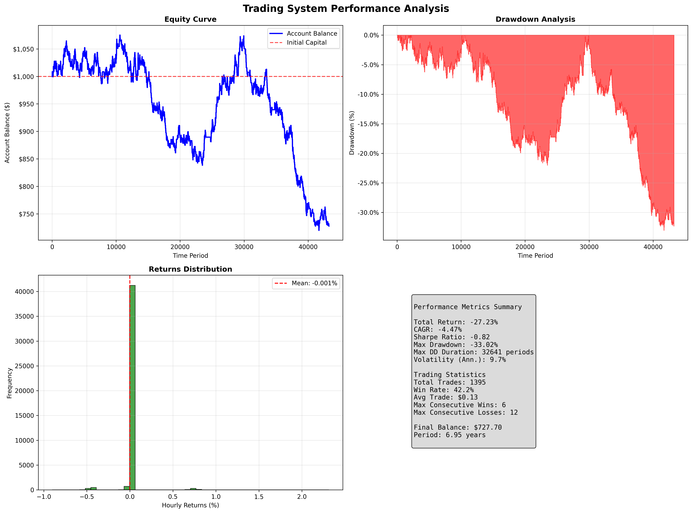

# EURUSD Direction Forecasting — Deep Learning Ensemble

A PyTorch research pipeline that predicts the next-hour direction of EURUSD from
multi-timeframe technical features, together with an event-driven backtester that
turns those predictions into trades under explicit risk management.

The project is an honest, reproducible study of how far a small ensemble of
sequence models can get on a noisy financial target — including where it fails.

---

## Summary

| Item | Value |
| --- | --- |
| Task | Binary classification (next H1 bar up / down) |
| Instrument | EURUSD, H1 bars |
| Data | 43,504 bars, 2018-01-02 to 2024-12-31 (~7 years) |
| Features | 113 engineered technical indicators, 100-bar sequences |
| Model | 3-model ensemble (2x Transformer, 1x BiLSTM), ~11,300 input dims |
| Test accuracy | **56.99%** (vs. 50% chance) |
| Training time | ~25 min on an NVIDIA RTX 3060 |
| Deployment | ONNX export for external inference |

**The headline number is 56.99%, not a profitable trading system.** See
[Results](#results) and [Known Limitations](#known-limitations) for the full picture.

---

## Results

All figures below are read from the saved run metadata in
`models/ensemble_model_info_20250703_105700.json` and are reproducible.

### Predictive performance

| Metric | Value |
| --- | --- |
| Ensemble test accuracy | 56.99% |
| Best individual model | 56.99% (BiLSTM) |
| Weakest individual model | 56.15% (Transformer, secondary) |
| Ensemble weights | 0.251 / 0.247 / 0.502 |
| Train / test samples | 30,347 / 13,007 |

Accuracy is measured on a held-out chronological split with a purge gap between
training and test windows. Three independently initialised models landing within
0.85 percentage points of each other is a useful signal: the result is stable
rather than the product of one lucky seed.

### Trading backtest

An event-driven backtest (spread 1.5 pips, slippage 0.3 pips, ATR-based stops)
was run over the full period with default parameters:

| Metric | Value |
| --- | --- |
| Total return | **-27.23%** over 6.95 years |
| CAGR | -4.47% |
| Sharpe ratio | -0.82 |
| Max drawdown | -33.02% |
| Win rate | 42.2% |
| Trades | 1,395 |

**Interpretation, stated plainly:** the strategy loses money. A 56.99% direction
accuracy is not enough to overcome spread and slippage at this trade frequency,
and the equity curve bleeds steadily after 2020.

This figure previously read +9.69% / Sharpe 0.01. That result was an artifact:
the backtester was feeding unnormalised features to a model trained on standardised
ones, so the reported equity curve came from inputs the network had never seen in
that form. Fixing the train/serve mismatch (see [Methodology notes](#methodology-notes))
reversed the sign of the result. The corrected number is the one shown above.



**What this means for the project:** the prediction model has a small but real
edge over chance; the trading layer built on top of it does not convert that edge
into profit. Separating those two findings is the point of this repository.

---

## Architecture

Three sequence models are trained independently and combined by accuracy-weighted
softmax, with poor performers suppressed:

```
TopPerformerEnsemble (num_classes = 2)
├── HighAccuracyTransformerNet        weight 0.251
│   ├── Multi-scale attention (scales 1, 2, 4)
│   ├── Advanced positional encoding
│   ├── Gradient checkpointing
│   └── Hierarchical avg + max pooling
├── HighAccuracyTransformerNet        weight 0.247
│   └── (higher dropout for decorrelation)
└── RTX3060SimpleForexNet             weight 0.502
    ├── Bidirectional LSTM
    ├── Channel attention (squeeze-excitation)
    └── Attention pooling
```

Each model emits direction logits, a price estimate and two uncertainty heads.
The direction head is the only output used for trading.

**Training configuration**

| Setting | Value |
| --- | --- |
| Optimiser | AdamW, weight decay 1e-4 |
| LR schedule | OneCycleLR (peak 3x base) |
| Loss | Focal loss (gamma=2) for class imbalance |
| Batch | 128 x 8 gradient accumulation (effective 1024) |
| Precision | Automatic mixed precision (FP16) |
| Regularisation | Early stopping, dropout, time-series augmentation |
| Epochs | 30 with early stopping |

---

## Methodology notes

These are the details that determine whether the reported numbers mean anything.

**No look-ahead in feature construction.** Regime-detection features use a
trailing 250-bar quantile. An earlier version computed the 80th percentile over
the entire series, which leaks future volatility levels into every row; this is
fixed and verified by a truncation test (recomputing features on a shorter slice
leaves earlier values unchanged).

**Purged chronological split.** A 100-bar embargo separates train and test. Without
it, the first test sequences are built from windows that overlap the training set
and the evaluation silently becomes partly in-sample.

**Train/serve parity.** Feature standardisation is fitted on the training set and
persisted in the model metadata (`scaler_mean` / `scaler_scale`). The scaler has
11,300 entries — one per (timestep, feature) position in the flattened window, not
one per feature — and the backtester reloads those exact statistics, so the ONNX
model receives inputs on the same scale it was trained on. Before this fix the
backtest passed raw, unnormalised features to the network and the resulting equity
curve was meaningless.

**Out-of-sample parameter tuning.** Trading parameters are searched on the
in-sample window only; the final 12 months are reserved as a holdout and used for
the reported validation. Tuning and reporting on the same window — the earlier
behaviour — produces optimistically biased results.

**Honest baseline.** Model accuracy is compared against the majority-class rate of
the test set, computed at runtime. A previous version compared against a hardcoded
"Random Forest 42.5%" figure for a model that does not exist in this repository.

---

## Known Limitations

Documented deliberately — these are the reasons the backtest does not translate
into a tradable edge.

1. **The strategy is not profitable.** -27.23% total return, Sharpe -0.82, -33%
   maximum drawdown over seven years. The direction model beats chance, but the
   trading layer does not convert that into profit after realistic costs.
2. **Accuracy alone is insufficient.** 56.99% overall hides asymmetric class
   performance; a directional edge also needs calibrated probabilities and
   favourable payoff geometry, neither of which is demonstrated here.
3. **The reported 56.99% was measured before the scaling fix.** It comes from the
   saved run metadata and the purge gap was applied afterwards, so a retrain is
   required to obtain a clean post-fix accuracy figure. Treat it as an upper
   estimate until then.
4. **Single instrument, single period.** EURUSD 2018-2024 only. No cross-market or
   cross-regime validation, so generalisation is untested.
5. **Synthetic price-action features.** Volume-based features (VWAP, VPT) are
   derived from a volatility proxy because the source data lacks real volume.
   Their information content is therefore limited.
6. **Feature engineering is duplicated.** The indicator logic exists in three
   files and is kept in sync manually. This is a maintenance hazard and the
   obvious refactor target.
7. **No hyperparameter search.** Architecture and optimiser settings were chosen
   manually; no systematic search or ablation was performed.
8. **No unit tests.** Validation is currently ad-hoc scripts rather than a test
   suite.

---

## Repository structure

```
deep-learning/
├── market_direction_deep_learning.py   Training: features, models, ensemble, ONNX export
├── backtest.py                         Event-driven backtester and parameter search
├── test_deep_learning_model.py         ONNX inference and rolling-accuracy evaluation
├── test_gpu.py                         CUDA / GPU diagnostics
├── merge_eurusd_data.py                M1 data merge utility
├── models/                             Trained weights, ONNX export, run metadata
├── requirements.txt                    Full dependency set
└── requirements_basic.txt              Minimal CPU-only set
```

---

## Getting started

**1. Install dependencies**

```bash
pip install -r requirements.txt
# CPU-only:
pip install -r requirements_basic.txt
```

**2. Install PyTorch with CUDA** (optional, for GPU training)

```bash
pip install torch torchvision --index-url https://download.pytorch.org/whl/cu118
python test_gpu.py
```

**3. Place the data file** `EURUSDm_H1_201801020600_202412310000.csv` in the
project root (MetaTrader 5 export, tab-separated). Data files are gitignored.

**4. Train**

```bash
python market_direction_deep_learning.py
```

Writes timestamped weights, metadata and an ONNX model to `models/`.

**5. Backtest**

```bash
python backtest.py     # option 1 = default parameters, option 3 = optimise + validate
```

**6. Evaluate the exported model**

```bash
python test_deep_learning_model.py --real
```

---

## Usage

```python
from backtest import Backtester

backtester = Backtester(
    model_path='models/best_model_20250703_105700.onnx',
    initial_capital=1000,
)
final_balance, trade_count = backtester.run_backtest(
    data, n_steps=100, generate_plots=False,
)
```

The backtester loads the fitted feature scaler from the model metadata
automatically; passing unscaled features to the ONNX graph will produce
meaningless predictions.

---

## Technical stack

PyTorch (CUDA, AMP, gradient checkpointing, TorchScript) · ONNX / ONNX Runtime ·
pandas · NumPy · scikit-learn · Matplotlib

---

## Data

MetaTrader 5 H1 export, tab-separated, columns `<DATE> <TIME> <OPEN> <HIGH> <LOW>
<CLOSE> <TICKVOL> <VOL> <SPREAD>`. 43,504 bars covering 2018-01-02 to 2024-12-31.
Only `<CLOSE>` is used for modelling; the backtester derives high/low from a
rolling volatility estimate for ATR.

---

## Roadmap

- [ ] Retrain after the leakage fixes to get a clean accuracy figure
- [ ] Extract feature engineering into a single shared module (removes triplication)
- [ ] Add a proper test suite: feature invariants, split integrity, train/serve parity
- [ ] Replace accuracy-only reporting with calibration curves and expected value
- [ ] Model the payoff geometry explicitly (risk/reward, expectancy per trade)
- [ ] Add cross-validation across instruments and time periods
- [ ] Add ablation study for the feature groups
- [ ] Realistic execution modelling (variable spread, session gaps)

---

## Disclaimer

Educational and research project. It is not financial advice and it is not a
profitable trading system — the backtest loses 27.23% with a Sharpe ratio of
-0.82. Foreign exchange trading carries substantial risk of loss. Do not deploy
this to a live account.

## License

Released for educational and research use.
